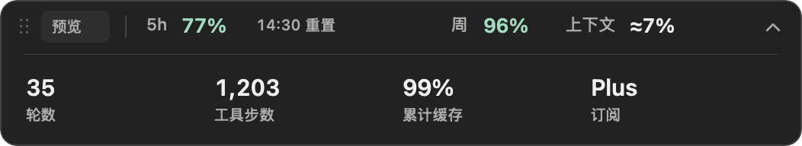

# Codex Desktop HUD v0.3.2 (macOS)

独立的 Codex 伴随 HUD。**没有顶部菜单栏图标，也不出现在 Dock**；仅在 Codex 置前且存在可见主窗口时显示，所有设置通过 HUD 右键菜单操作。不会修改或注入官方 App。

## 显示和操作

- 默认在窗口内部右上角显示紧凑条：`最近  5h 77%  14:30 重置  周 96%  上下文 ≈7%`。宽窗口靠标题栏右侧；宽度不足 1050 点时下移 48 点，减少遮挡标题。
- 拖动条上任意位置即可移动，范围限制在 Codex 窗口内，离边缘至少 8 点。位置按窗口内的相对比例保存，移动、缩放窗口时继续跟随。
- 点击展开或收起。展开为两行布局：顶部保留额度与上下文，下面分区显示轮数、工具步数、累计缓存和订阅。有重置时间时，收起尺寸为 526 × 36 点，展开为 526 × 96 点；窄窗口自动将重置时间放在 5h 下方，并增加 14 点高度。没有重置时间时保持 410 点宽度；悬停可查看完整数值。
- 右键：展开/收起、恢复右上角、立即刷新额度、绑定聊天、订阅标签、退出。
- 隐藏 Codex、最小化、关闭可见窗口或切到其他应用时，HUD 自动隐藏。检测间隔约 150 毫秒；不是与宿主同一帧更新。
- 退出 Codex 应用时，HUD 进程随之退出。仅关闭窗口时隐藏并等待新窗口；重新启动 Codex 应用后需重新打开 HUD。
- 不自动开机启动。

HUD 是独立的浮层，**不是官方标题栏内嵌组件**，无法取得标题的实际文字边界。长标题仍可能与默认位置重叠，可以拖到空白处；多窗口时跟随前台 Codex 的最上层合适窗口。

## 效果图

以下为原生 HUD 控件渲染的效果图，标注「预览」并使用示例数值。

收起：


展开：



额度不足：


## 构建并打开

需要 macOS 12+、Xcode Command Line Tools (`swiftc`) 和 Python 3：

```bash
cd codex-desktop-hud
sh install.sh
```

安装到 `~/Applications/Codex Desktop HUD.app` 并打开；更新时自动重新启动 HUD，无需重启 Codex。然后切回 Codex，HUD 才会显示；菜单栏没有入口是正常行为。

```bash
open "$HOME/Applications/Codex Desktop HUD.app"
```

安装时记录 Python 和可用 Codex CLI 的绝对路径，避免从 Finder 启动时 PATH 缺少 Homebrew/nvm 路径。运行时优先寻找 `com.openai.codex` 对应 App 的内置 CLI，再回退到安装时记录的 CLI。若更换 Python/CLI 安装位置，请重新运行安装脚本。

卸载前右键 HUD → 退出，然后运行 `sh uninstall.sh`。

## 5h 下一轮重置时间

5h 剩余额度后显示官方接口 `resetsAt`（或日志 `resets_at`）提供的重置时间，例如 `77% 14:30 重置`。按 macOS 当前系统时区显示，跨日标注「明日」，更远日期显示月/日。时间来自同一个 5h 额度窗口，不会从周额度借用，也不会自行推算「现在 + 5 小时」。

接口没有返回时间，或时间已经过去时，隐藏这项；额度继续按原有的 90 秒周期刷新。重置时间与 HUD 自身的数据刷新时间不同。

窄窗口示例（示例数据）：


## 当前聊天和绑定

自动模式在系统提供窗口标题时，尝试与本地 Codex 线程索引中的**唯一完整标题**匹配。匹配成功显示「当前」。系统可能不提供标题，或者标题不是聊天名，此时显示「最近」，明确表示最近活动的桌面会话，不能保证对应当前侧边栏选择。

需要确定地查看某个聊天时：右键 HUD → **绑定聊天** → 选择聊天。绑定跨 HUD 重启保存，显示「锁定」；切换 Codex 聊天不会自动解除锁定。绑定的会话被归档、删除或日志不可用时显示「失效」和缺失值，不会自动替换为其他聊天。选回自动模式即可解除。列表每 30 秒刷新，菜单列出最近 30 个可用桌面聊天。

这个方案改善会话误读，但没有官方选中聊天 IPC，因此不能承诺在所有客户端版本中自动识别当前聊天。无需为 HUD 开启辅助功能或屏幕录制权限；没有标题也能用手动绑定。

## 数值的实际含义

| 字段 | 数据和限制 |
|---|---|
| 第 N 轮 | 会话日志 `task_started` 数量；旧格式回退到用户消息数，不是全局轮数 |
| X 步 | `function_call`、`custom_tool_call`、`web_search_call` 数量，不是内部思考步骤 |
| 上下文 ≈X% | 最近模型输入加可见输出，除以日志中的上下文窗口。是估算，不是逐 Token 实时值，压缩后的精确占用无法从日志还原 |
| 缓存 X% | 会话累计缓存输入 / 累计输入，并非当前请求的缓存命中率 |
| Plus / Pro | 官方账户接口返回的套餐；Pro x5/x10 只能手动标注，不代表已识别或改变实际订阅 |
| 5h / 周 | 官方额度窗口的 `100 - usedPercent`，按窗口实际时长分类；无该窗口显示 `--` |

右键菜单可查看当前会话来源。悬停可查看全部指标、绑定方式和额度来源。

## 数据和隐私

- 从 `CODEX_HOME`（默认 `~/.codex`）下 `sessions/`、`archived_sessions/` 的 `rollout-*.jsonl` 读取数字事件。
- 为匹配/绑定聊天，以只读模式查询 `state_*.sqlite` 的线程 ID、标题、日志路径和来源；不修改 Codex 数据库。数据库结构由 Codex 控制，未来变化可能使绑定列表暂时不可用。
- 默认每 90 秒调用本地 `codex app-server`，读取 `account/read` 和 `account/rateLimits/read`。该官方进程使用已有登录状态并可能请求官方网络服务；HUD 本身不读取或导出 `auth.json`。
- 额度接口失败时，可回退到 15 分钟内的会话额度事件；有效接口缓存最多使用 10 分钟。
- 本地 `~/Library/Caches/CodexDesktopHUD/` 只保存额度、数字统计和日志路径/增量游标，不保存对话正文或令牌。偏好设置保存位置、套餐显示标签和手动绑定的线程 ID。
- 不会上传对话、代码或本地路径，不需要管理员权限。

## 验证与诊断

```bash
python3 Sources/tracker.py --doctor
python3 Sources/tracker.py --quota
python3 Sources/tracker.py --sessions
python3 Sources/tracker.py --thread-id YOUR_THREAD_ID
python3 Sources/tracker.py --demo
python3 -m unittest discover -s tests -v
swiftc Sources/HUDGeometry.swift tests/test_geometry.swift -o /tmp/codex-hud-geometry-tests
/tmp/codex-hud-geometry-tests
swiftc Sources/HUDTime.swift tests/test_time.swift -o /tmp/codex-hud-time-tests
/tmp/codex-hud-time-tests
```

本版已在 Mac 上完成原生应用编译、16 项 Python 测试、Swift 时间格式测试和几何测试（拖动限制、展开宽度、窗口缩小、负屏幕坐标）。真实会话与账户额度读取已验证。当前电脑控制工具禁止访问 Codex 窗口，所以**尚未完成真实宿主中的视觉、拖动及隐藏/最小化/退出端到端验证**；不能把编译通过当作这些行为已经实测通过。

自定义环境可设置 `CODEX_HOME` 和 `CODEX_HUD_BINARY`。从 Finder 启动的应用不一定继承终端环境，请从同一终端打开应用或使用 macOS 的 GUI 环境设置。

本项目是独立的非官方伴随工具，与 OpenAI 没有隶属关系。

## 样式预览

炭灰底色、11 点圆角、系统字体、等宽数字、悬停反馈和手绘拖动/展开图标。额度充足为浅绿色，低于或等于 50% 为琥珀色，低于或等于 20% 为红色，缺失值为中性色。

`previews/` 中是原生 AppKit 控件的 2 倍分辨率渲染，使用明确标注的示例数据，不是宿主截图。可重新生成：

```bash
"$HOME/Applications/Codex Desktop HUD.app/Contents/MacOS/CodexHUD" --render-preview "$PWD/previews"
```
